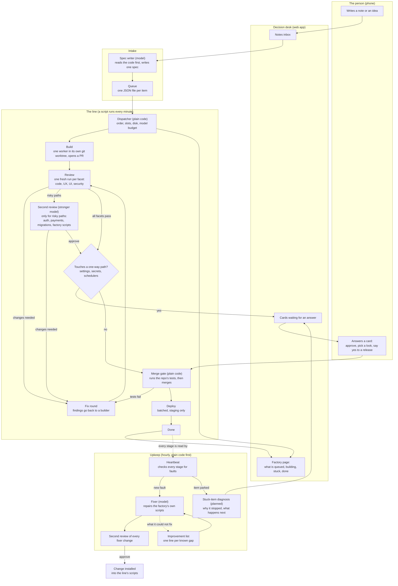

# A one-person software factory: the whole flow

This is how one person runs several software products from one Mac. Plain shell scripts move each piece of work
through fixed stages. AI models do the building and reviewing. The person answers cards on a phone.

## The line

## Who does what

| Stage | Done by | Why |
|---|---|---|
| Ordering, slots, retries, timeouts, merging | Plain shell code | The same input has to give the same result every time |
| Spec, build, review | A cheap coding model first, a mid-priced model when the cheap one is out of quota | Most runs are these |
| Second review of risky work | A stronger model from a different family | It was not trained like the builder, so it misses different things |
| Repairing the factory itself | The strongest model, reviewed by another | There are few of these runs, and a bad one breaks every product's line |
| Releases, spending, anything public | The person, one tap on a card | These cannot be undone |

## Where it jams, and what we did

| Jam | What it looked like | Fix | Status |
|---|---|---|---|
| Model quota | The cheap model's 5-hour quota ran out and every build waited for the reset | Route each job by how much of each quota is left for the time remaining; near-finished work goes first | Planned |
| Fix loops | An item bounced between review and fix until it hit the retry cap and parked | A cap on rounds, then a diagnosis run that says why and proposes a split or a new spec | Cap live; diagnosis planned |
| A gate that passed red tests | The test command piped output through `tail`, which hid the failing exit code | The gate keeps the test tool's own exit code | Queued |
| A yes that did not carry | A one-way approval was tied to one commit, so a routine merge from main asked again | The yes carries over while the one-way files are unchanged | In review |
| Rules nobody loaded | Each product had a rules page that no build or review prompt read | The build, review and second-review prompts start with the product's rules page | Planned |
| Self-repair starved | Fault repairs took every fixer slot, so the improvement list never moved | A repair run that ends starts the improvement run that is due | Live |
| Answers nobody acted on | A card was answered and no run picked the answer up | One reader in the factory turns each answered card into queued work or a hand-off | Queued |
| Stale instructions | Rule files described chats, queues and features that no longer existed | A read-only audit of every instruction file, with the fixes queued as normal items | Audit done; fixes queued |

## Rules we kept

- Each state file has one writer. Models never write the queue.
- A model may raise an item's risk class. It may never lower it.
- One "changes needed" verdict blocks the merge. Reviewers do not vote.
- Text from issues, PRs and notes is treated as data. No run takes instructions from it.
- Model budgets are paced by how much quota is left for the time remaining. There are no fixed cutoffs.
- Plain code does the monitoring. A model run starts only when that code finds a fault.
