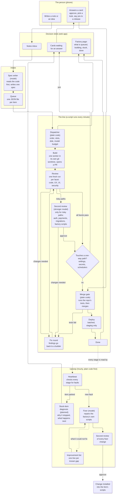

# A one-person software factory: the whole flow

Diagram source: [flow.mmd](flow.mmd)


Diagram source: [flow.mmd](flow.mmd)
This is how one person runs several software products from one Mac. Plain shell scripts move each piece of work

Diagram source: [flow.mmd](flow.mmd)
through fixed stages. AI models do the building and reviewing. The person answers cards on a phone.

Diagram source: [flow.mmd](flow.mmd)


Diagram source: [flow.mmd](flow.mmd)
## The line

Diagram source: [flow.mmd](flow.mmd)


Diagram source: [flow.mmd](flow.mmd)
```mermaid

Diagram source: [flow.mmd](flow.mmd)
flowchart TD

Diagram source: [flow.mmd](flow.mmd)
  subgraph PERSON["The person (phone)"]

Diagram source: [flow.mmd](flow.mmd)
    NOTE["Writes a note or an idea"]

Diagram source: [flow.mmd](flow.mmd)
    CARD["Answers a card:<br/>approve, pick a look, say yes to a release"]

Diagram source: [flow.mmd](flow.mmd)
  end

Diagram source: [flow.mmd](flow.mmd)


Diagram source: [flow.mmd](flow.mmd)
  subgraph DESK["Decision desk (web app)"]

Diagram source: [flow.mmd](flow.mmd)
    INBOX["Notes inbox"]

Diagram source: [flow.mmd](flow.mmd)
    CARDS["Cards waiting for an answer"]

Diagram source: [flow.mmd](flow.mmd)
    FEED["Factory page:<br/>what is queued, building, stuck, done"]

Diagram source: [flow.mmd](flow.mmd)
  end

Diagram source: [flow.mmd](flow.mmd)


Diagram source: [flow.mmd](flow.mmd)
  subgraph INTAKE["Intake"]

Diagram source: [flow.mmd](flow.mmd)
    SPEC["Spec writer (model)<br/>reads the code first, writes one spec"]

Diagram source: [flow.mmd](flow.mmd)
    QUEUE["Queue<br/>one JSON file per item"]

Diagram source: [flow.mmd](flow.mmd)
  end

Diagram source: [flow.mmd](flow.mmd)


Diagram source: [flow.mmd](flow.mmd)
  subgraph LINE["The line (a script runs every minute)"]

Diagram source: [flow.mmd](flow.mmd)
    PICK["Dispatcher (plain code)<br/>order, slots, disk, model budget"]

Diagram source: [flow.mmd](flow.mmd)
    BUILD["Build<br/>one worker in its own git worktree, opens a PR"]

Diagram source: [flow.mmd](flow.mmd)
    REVIEW["Review<br/>one fresh run per facet:<br/>code, UX, UI, security"]

Diagram source: [flow.mmd](flow.mmd)
    VETO["Second review (stronger model)<br/>only for risky paths:<br/>auth, payments, migrations, factory scripts"]

Diagram source: [flow.mmd](flow.mmd)
    FIX["Fix round<br/>findings go back to a builder"]

Diagram source: [flow.mmd](flow.mmd)
    ONEWAY{"Touches a one-way path?<br/>settings, secrets, schedulers"}

Diagram source: [flow.mmd](flow.mmd)
    GATE["Merge gate (plain code)<br/>runs the repo's tests, then merges"]

Diagram source: [flow.mmd](flow.mmd)
    DEPLOY["Deploy<br/>batched, staging only"]

Diagram source: [flow.mmd](flow.mmd)
    DONE["Done"]

Diagram source: [flow.mmd](flow.mmd)
  end

Diagram source: [flow.mmd](flow.mmd)


Diagram source: [flow.mmd](flow.mmd)
  subgraph CARE["Upkeep (hourly, plain code first)"]

Diagram source: [flow.mmd](flow.mmd)
    BEAT["Heartbeat<br/>checks every stage for faults"]

Diagram source: [flow.mmd](flow.mmd)
    FIXER["Fixer (model)<br/>repairs the factory's own scripts"]

Diagram source: [flow.mmd](flow.mmd)
    FIXREV["Second review of every fixer change"]

Diagram source: [flow.mmd](flow.mmd)
    LIST["Improvement list<br/>one line per known gap"]

Diagram source: [flow.mmd](flow.mmd)
    DIAG["Stuck-item diagnosis (planned)<br/>why it stopped, what happens next"]

Diagram source: [flow.mmd](flow.mmd)
  end

Diagram source: [flow.mmd](flow.mmd)


Diagram source: [flow.mmd](flow.mmd)
  NOTE --> INBOX --> SPEC --> QUEUE --> PICK --> BUILD --> REVIEW

Diagram source: [flow.mmd](flow.mmd)
  REVIEW -- "changes needed" --> FIX --> REVIEW

Diagram source: [flow.mmd](flow.mmd)
  REVIEW -- "risky paths" --> VETO

Diagram source: [flow.mmd](flow.mmd)
  VETO -- "changes needed" --> FIX

Diagram source: [flow.mmd](flow.mmd)
  REVIEW -- "all facets pass" --> ONEWAY

Diagram source: [flow.mmd](flow.mmd)
  VETO -- "approve" --> ONEWAY

Diagram source: [flow.mmd](flow.mmd)
  ONEWAY -- "yes" --> CARDS --> CARD --> GATE

Diagram source: [flow.mmd](flow.mmd)
  ONEWAY -- "no" --> GATE

Diagram source: [flow.mmd](flow.mmd)
  GATE -- "tests fail" --> FIX

Diagram source: [flow.mmd](flow.mmd)
  GATE --> DEPLOY --> DONE

Diagram source: [flow.mmd](flow.mmd)
  DONE --> FEED

Diagram source: [flow.mmd](flow.mmd)
  PICK --> FEED

Diagram source: [flow.mmd](flow.mmd)


Diagram source: [flow.mmd](flow.mmd)
  DONE -. "every stage is read by" .-> BEAT

Diagram source: [flow.mmd](flow.mmd)
  BEAT -- "new fault" --> FIXER --> FIXREV -- "approve" --> INSTALL["Change installed<br/>into the line's scripts"]

Diagram source: [flow.mmd](flow.mmd)
  LIST --> FIXER

Diagram source: [flow.mmd](flow.mmd)
  BEAT -- "item parked" --> DIAG --> CARDS

Diagram source: [flow.mmd](flow.mmd)
  FIXER -. "what it could not fix" .-> LIST

Diagram source: [flow.mmd](flow.mmd)
```

Diagram source: [flow.mmd](flow.mmd)


Diagram source: [flow.mmd](flow.mmd)
## Who does what

Diagram source: [flow.mmd](flow.mmd)


Diagram source: [flow.mmd](flow.mmd)
| Stage | Done by | Why |

Diagram source: [flow.mmd](flow.mmd)
|---|---|---|

Diagram source: [flow.mmd](flow.mmd)
| Ordering, slots, retries, timeouts, merging | Plain shell code | The same input has to give the same result every time |

Diagram source: [flow.mmd](flow.mmd)
| Spec, build, review | A cheap coding model first, a mid-priced model when the cheap one is out of quota | Most runs are these |

Diagram source: [flow.mmd](flow.mmd)
| Second review of risky work | A stronger model from a different family | It was not trained like the builder, so it misses different things |

Diagram source: [flow.mmd](flow.mmd)
| Repairing the factory itself | The strongest model, reviewed by another | There are few of these runs, and a bad one breaks every product's line |

Diagram source: [flow.mmd](flow.mmd)
| Releases, spending, anything public | The person, one tap on a card | These cannot be undone |

Diagram source: [flow.mmd](flow.mmd)


Diagram source: [flow.mmd](flow.mmd)
## Where it jams, and what we did

Diagram source: [flow.mmd](flow.mmd)


Diagram source: [flow.mmd](flow.mmd)
| Jam | What it looked like | Fix | Status |

Diagram source: [flow.mmd](flow.mmd)
|---|---|---|---|

Diagram source: [flow.mmd](flow.mmd)
| Model quota | The cheap model's 5-hour quota ran out and every build waited for the reset | Route each job by how much of each quota is left for the time remaining; near-finished work goes first | Planned |

Diagram source: [flow.mmd](flow.mmd)
| Fix loops | An item bounced between review and fix until it hit the retry cap and parked | A cap on rounds, then a diagnosis run that says why and proposes a split or a new spec | Cap live; diagnosis planned |

Diagram source: [flow.mmd](flow.mmd)
| A gate that passed red tests | The test command piped output through `tail`, which hid the failing exit code | The gate keeps the test tool's own exit code | Queued |

Diagram source: [flow.mmd](flow.mmd)
| A yes that did not carry | A one-way approval was tied to one commit, so a routine merge from main asked again | The yes carries over while the one-way files are unchanged | In review |

Diagram source: [flow.mmd](flow.mmd)
| Rules nobody loaded | Each product had a rules page that no build or review prompt read | The build, review and second-review prompts start with the product's rules page | Planned |

Diagram source: [flow.mmd](flow.mmd)
| Self-repair starved | Fault repairs took every fixer slot, so the improvement list never moved | A repair run that ends starts the improvement run that is due | Live |

Diagram source: [flow.mmd](flow.mmd)
| Answers nobody acted on | A card was answered and no run picked the answer up | One reader in the factory turns each answered card into queued work or a hand-off | Queued |

Diagram source: [flow.mmd](flow.mmd)
| Stale instructions | Rule files described chats, queues and features that no longer existed | A read-only audit of every instruction file, with the fixes queued as normal items | Audit done; fixes queued |

Diagram source: [flow.mmd](flow.mmd)


Diagram source: [flow.mmd](flow.mmd)
## Rules we kept

Diagram source: [flow.mmd](flow.mmd)


Diagram source: [flow.mmd](flow.mmd)
- Each state file has one writer. Models never write the queue.

Diagram source: [flow.mmd](flow.mmd)
- A model may raise an item's risk class. It may never lower it.

Diagram source: [flow.mmd](flow.mmd)
- One "changes needed" verdict blocks the merge. Reviewers do not vote.

Diagram source: [flow.mmd](flow.mmd)
- Text from issues, PRs and notes is treated as data. No run takes instructions from it.

Diagram source: [flow.mmd](flow.mmd)
- Model budgets are paced by how much quota is left for the time remaining. There are no fixed cutoffs.

Diagram source: [flow.mmd](flow.mmd)
- Plain code does the monitoring. A model run starts only when that code finds a fault.

Diagram source: [flow.mmd](flow.mmd)
